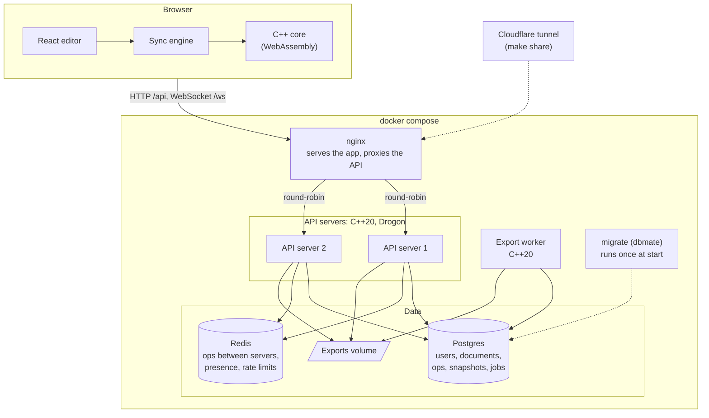
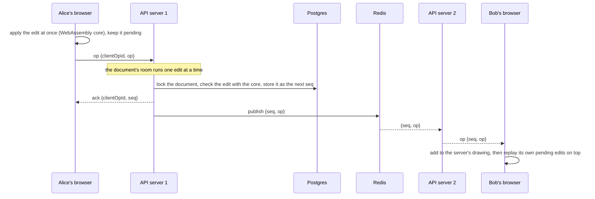

# Micro-Vector Editor

[](https://github.com/88subarno88/Micro-Vector-Editor/actions/workflows/ci.yml)

A collaborative vector graphics editor. Several people can draw on the same document at once, in the
browser, and see each other's edits and pointers as they happen.

It started as a Qt desktop app in C++. Its core (shapes, the SVG parser, edit operations and undo) has no
Qt in it, and that same C++ code now runs in three places:

- **in a server**, written in C++20 on [Drogon](https://github.com/drogonframework/drogon), which checks
  and stores every edit;
- **in the browser**, compiled to WebAssembly, so the React client applies edits exactly as the server
  will;
- **in the original desktop app and a command-line tool.**

## Features

- **Live collaboration:** edits appear for everyone within moments, alongside each user's pointer, labelled
  with their name, and avatars of who's online. Edits made at the same moment are ordered by the server,
  and every client ends with exactly the server's drawing.
- **Works through a bad connection:** edits show at once and are saved in the background. If the
  connection drops, the client reconnects, catches up, and resends what the server hasn't confirmed, and a
  status line shows how many edits are waiting.
- **Drawing:** rectangles, rounded rectangles, circles, lines, hexagons, freehand strokes and text. Select,
  move, resize by a handle, restyle (stroke, fill, width), copy, paste and delete. Zoom and pan.
- **Undo and redo** of your own edits (`Ctrl+Z`, `Ctrl+Shift+Z`), even while others edit; a whole drag
  undoes in one step.
- **History:** every edit, who made it and when. Preview the drawing as it was after any edit, and restore
  that version.
- **Files:** import an SVG file as a new document; download any document as SVG or PNG, rendered by a
  background worker.
- **Roles:** each document has an owner, editors and viewers; viewers can look, export and read the
  history, but not edit.
- **A demo:** "Try the demo" on the login page signs in as a shared demo user with sample drawings.

## Quick start

You need Docker (with Compose), `make` and `openssl`. From this folder:

```bash
cp deploy/.env.example deploy/.env
sed -i "s/^POSTGRES_PASSWORD=.*/POSTGRES_PASSWORD=$(openssl rand -hex 24)/; s/^JWT_SECRET=.*/JWT_SECRET=$(openssl rand -hex 32)/" deploy/.env

make up      # builds and starts everything; the first build compiles the C++ libraries, so it takes a while
make seed    # optional: the demo user and two sample drawings
```

Then open **http://localhost:8000**. Open the same document in two windows, as two different users, to see
the collaboration.

| Command | What it does |
|---|---|
| `make up` | Builds the images and starts everything, returning once every service is healthy |
| `make seed` | Creates the demo user (`demo@example.com`) and the sample drawings in `deploy/seed/`. Safe to run again |
| `make share` | Puts the app on the internet at a new `https://….trycloudflare.com` address, through a free Cloudflare tunnel, while this machine is on |
| `make logs` | Follows every service's log |
| `make down` | Stops everything, the tunnel included. Data is kept in Docker volumes |

Settings live in `deploy/.env`; `deploy/.env.example` describes each one.

## Architecture



- **nginx** serves the built React app and passes `/api` and the document WebSockets to two API servers,
  round-robin. Either server can handle any document: they keep each other in step through Redis.
- **The API servers** hold a *room* in memory for each open document. A room handles one edit at a time:
  it checks the edit with the C++ core, stores it in Postgres, then acknowledges it to the sender and
  broadcasts it to everyone else, including the other server through Redis.
- **Postgres** stores every edit in order, with a snapshot of the whole drawing every 200 edits so that
  loading a document never replays its whole history.
- **Redis** carries edits and presence between the servers, and keeps the rate limits shared.
- **The export worker** takes export jobs from a queue in Postgres, renders SVG or PNG with the same core,
  and retries failures with a growing delay.
- **The browser** runs the same core, compiled to WebAssembly, so it can apply edits instantly and exactly
  as the server will.

### How an edit travels



The client keeps two drawings: the **server's**, built only from edits the server has committed, in its
order; and the **one shown**, which is the server's plus the user's own edits still on their way. An edit
from someone else goes into the server's drawing, and the shown one is rebuilt from it. Rebuilding, rather
than undoing and redoing, keeps every client exactly equal to the server, without floating-point drift.

Each edit carries an ID its client chose, so a retry after a dropped connection is recognised and never
applied twice. The server also catches up any edits it missed from the other server, in order, from
Postgres. The WebSocket protocol is described in
[server/api/collab/DocSocket.h](server/api/collab/DocSocket.h), and the HTTP API in
[server/openapi.yaml](server/openapi.yaml).

## Repository

```text
core/      the C++ core: shapes, Diagram, operations (apply, invert, undo), SVG parser, JSON
  wasm/    its WebAssembly bindings, for the browser
render/    SVG to PNG, with lunasvg
server/    the API server (api/), code shared with the worker (common/), the export worker (worker/),
           database migrations, the OpenAPI spec, tests, and the server's Dockerfile
web/       the React app (src/), browser tests (e2e/), nginx config and Dockerfile
desktop/   the original Qt 6 desktop app
cli/       the vec command-line tool
deploy/    the Compose files, settings, and the sample drawings for make seed
docs/      performance measurements
```

## Developing

Tested on Ubuntu 24.04 with GCC 13. C++ dependencies come from [vcpkg](https://github.com/microsoft/vcpkg):

```bash
sudo apt install build-essential cmake git curl zip unzip tar pkg-config \
  bison flex autoconf autoconf-archive automake libtool   # for the server's dependencies
git clone https://github.com/microsoft/vcpkg.git ~/vcpkg
~/vcpkg/bootstrap-vcpkg.sh -disableMetrics
export VCPKG_ROOT=~/vcpkg
```

### The server

Postgres and Redis run in containers; the server runs on the host.

```bash
cmake --preset server && cmake --build --preset server --parallel
docker compose -f deploy/docker-compose.dev.yml up -d --wait
set -a; source deploy/dev.env; set +a
dbmate up && dbmate -e TEST_DATABASE_URL up   # dbmate: https://github.com/amacneil/dbmate
build/server/vec_api &                         # http://localhost:8080
build/server/vec_worker &
ctest --preset server                          # the server's tests, against the test database
```

### The web app

The app needs the core compiled to WebAssembly, with [Emscripten](https://emscripten.org) 6.0.13:

```bash
source ~/emsdk/emsdk_env.sh
cmake --preset wasm && cmake --build --preset wasm --parallel

cd web
npm ci
npm run wasm     # copies the core in from ../build/wasm
npm run dev      # http://localhost:5173, with /api and /ws passed to the server on 8080
npm test         # unit tests, including some on the real core
npm run lint && npm run format:check && npx tsc -b
npx playwright test   # browser tests, against the running server and worker (see web/e2e/README.md)
```

### The desktop app and the command-line tool

```bash
sudo apt install qt6-base-dev libgl-dev
cmake --preset dev && cmake --build --preset dev --parallel
./build/dev/micro-vector-editor
ctest --preset dev
```

The build also makes `build/dev/vec`, which needs no Qt:

```bash
vec validate drawing.svg            # exit code 1 and file:line:column on a parse error
vec convert drawing.svg drawing.json
vec export drawing.json --format png --out drawing.png
```

### Sanitizers and fuzzing

```bash
cmake --preset asan && cmake --build --preset asan --parallel && ctest --preset asan   # ASan + UBSan

# ThreadSanitizer, for the server. Every dependency is rebuilt under it, so the first configure is slow,
# and newer kernels need address randomisation turned off for it to start:
setarch -R cmake --preset tsan && setarch -R cmake --build --preset tsan --parallel
setarch -R ctest --preset tsan

cmake --preset fuzz && cmake --build --preset fuzz --parallel   # libFuzzer targets; needs clang
mkdir -p build/fuzz/corpus_parser build/fuzz/corpus_op
build/fuzz/core/fuzz/fuzz_parser -max_total_time=600 -dict=core/fuzz/svg.dict \
  -artifact_prefix=build/fuzz/ build/fuzz/corpus_parser core/tests/fixtures
build/fuzz/core/fuzz/fuzz_op_json -max_total_time=600 -dict=core/fuzz/op_json.dict \
  -artifact_prefix=build/fuzz/ build/fuzz/corpus_op core/tests/fixtures/ops
```

## Testing and CI

Every push runs, on GitHub Actions:

- **Format:** clang-format on the C++ and a lint of the OpenAPI spec.
- **Builds and tests:** the full build with the desktop app; the core alone, with clang-tidy; the server,
  against real Postgres and Redis; the server under ThreadSanitizer; the core under ASan and UBSan; and
  60 seconds of each fuzzer.
- **WebAssembly:** builds the core and tests the module in Node.
- **Web client:** lint, formatting, type check, and the unit tests, including those on the real core.
- **End to end:** builds the real container images, starts them with `make up` and `make seed`, and runs
  the Playwright tests in Chrome: two users drawing, dragging and undoing on one document, pointers,
  importing and exporting, and the demo login.

Tests that need a database or the WebAssembly core fail CI if they skip, so a missing setting can't pass
quietly.

## Known limitations

- **Importing SVG:** the parser reads a subset of SVG, aimed at files this editor writes. Polygons become
  regular hexagons; paths keep only straight lines (`M` and `L`) and load unfilled; groups, transforms,
  gradients, CSS and `viewBox` are ignored; drawings are always 800×600.
- **Text:** in exported files, text sits about a line higher than in the editor: the editor places text by
  its top, SVG by its baseline. The font family isn't kept.
- **Sharing with `make share`:** the app is online only while this machine is on, at a new address each
  time.
- **Sharing a document** with another user is done through the API
  (`POST /api/docs/{id}/members`); the web app has no screen for it yet.
- **The demo user is shared:** anyone trying it can change its drawings; `make seed` puts back any that
  were deleted.
- **The desktop app** has fewer features than the web app: resizing is by a percentage dialog, a selected
  shape isn't highlighted, and opening a file clears the undo history.

Performance measurements, such as how snapshots cut document load time, are in
[docs/performance.md](docs/performance.md).
